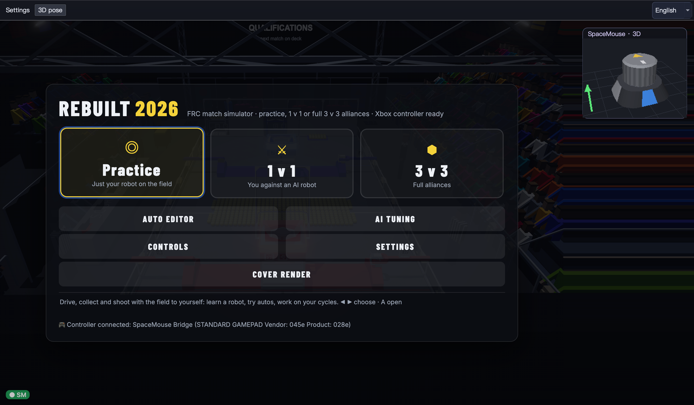

# SpaceMouse Swerve

Drive an FRC swerve simulator with a 3Dconnexion SpaceMouse.

[简体中文](README.zh-CN.md) · [macOS validation](MACOS_VALIDATION.md) · [MIT license](LICENSE)

The Mac desktop app puts the game, controller connection, tuning and live 3D device pose in one window. It bundles Python and Chromium: no Terminal, bookmarklet or browser extension is needed.



## Mac app

[Download v1.0.0-beta.1 for Apple Silicon](https://github.com/peterpyyyyy/spacemouse-swerve/releases/tag/v1.0.0-beta.1).

1. Install the official **3DxWare for macOS** and connect your SpaceMouse. **Leave 3DconnexionHelper running.** The app uses the installed driver API so the cap does not become a desktop mouse.
2. Open **SpaceMouse Swerve.app** and let the game load.
3. Use your mouse to navigate the game's menus. SpaceMouse input unlocks in the gameplay view, and locks again in menus and pause screens.
4. Click the game to focus it. Push/tilt to translate, twist to rotate. Hold **J** to intake, **K** to shoot, **L** to pass, and **;** to eject during manual play.

Use **Settings** to collapse the left panel, **3D pose** to show/hide the corner overlay, and the language menu to switch the app between Chinese and English. These choices persist across launches. The embedded third-party game retains its own menus.

**Calibrate / practice** opens the local simulator; press **K** there for direction calibration. Closing practice returns control to the embedded game. User calibration and settings live in `~/Library/Application Support/SpaceMouse Swerve`, outside the app bundle.

The packaged build targets **Apple Silicon, macOS 14+**. It is locally ad-hoc signed, **not Apple notarized**. Test evidence currently covers a SpaceMouse Wireless BT over USB on one Apple Silicon Mac with 3DxWare installed. Bluetooth, other device models and Intel builds have not been validated. Online games require internet access.

## Run or build from source

```bash
python3 -m venv .venv
.venv/bin/python -m pip install -r requirements-app.txt
.venv/bin/python macos_app.py
```

Build the standalone arm64 app on an Apple Silicon Mac:

```bash
./tools/build_macos_app.sh
# dist/SpaceMouse Swerve.app
```

The app loads the installed 3Dconnexion client framework at runtime; it does not redistribute that proprietary framework. Qt, Python and other bundled dependencies retain their own licenses; see [third-party notices](THIRD_PARTY_NOTICES.md).

## Existing standalone tools

- `swerve_sim.py`: local top-down swerve simulator, direction calibration and 3D input visualization.
- `spacemouse_bridge.py`: local WebSocket + bookmarklet bridge for an external browser.
- `run_*.command` / `run_*.bat`: source launchers.

These tools use `requirements.txt`; the large desktop dependencies are optional. On macOS with 3DxWare installed they read through the driver API. The raw HID fallback is experimental on systems without the vendor framework. Windows/Linux desktop app builds are not provided.

The default FUSE mode blends pan and tilt direction while taking the larger magnitude, avoiding doubled speed. PAN, TILT, SUM and DOMINANT modes remain available.

## Checks

```bash
.venv/bin/python -m unittest discover -s tests -v
node tests/test_gamepad.cjs
.venv/bin/python -m pip check
```

The Python tests cover HID reports, driver lifecycle and state paths; the JavaScript checks cover keyboard release, focus loss, pause, disconnect and menu input locking. They supplement real-device testing and do not replace it.

## Credits

The embedded game is [REBUILT Sim 2026 by Tyler Handel](https://github.com/tylerhandel/rebuilt-sim-2026); the second preset opens [frc4206.com](https://www.frc4206.com/). Their code/assets are loaded from their own servers and are not part of this repository or app bundle. This project is not affiliated with 3Dconnexion, FIRST or those simulator authors.
